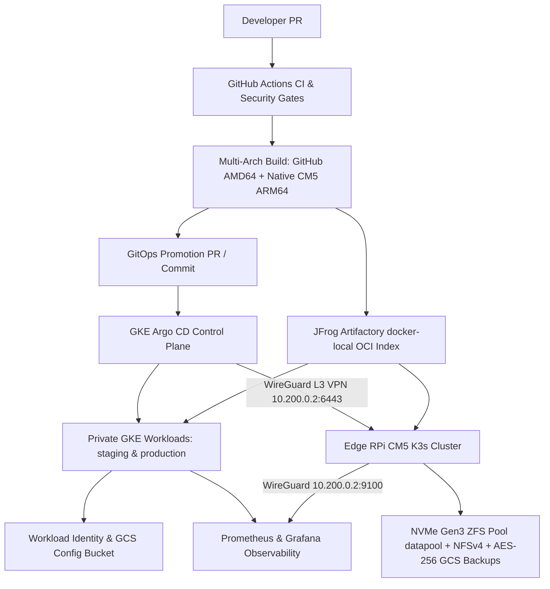

# Python GKE Platform & Raspberry Pi CM5 Hybrid Edge

Cloud-native Python FastAPI platform deployed on **Google Kubernetes Engine (GKE)** and extended to an on-premises **Raspberry Pi Compute Module 5 (ARM64) Hybrid Edge Appliance** via **Terraform**, **Ansible**, **Argo CD GitOps**, **WireGuard L3 VPN**, **ZFS on Gen3 NVMe**, **JFrog Artifactory (Multi-Arch OCI)**, and **Prometheus/Grafana**.

---

## 1. Architecture Overview



---

## 2. Key Engineering Capabilities
- **Private GKE & Terraform IaC (`infra/`):** Custom VPC (`10.20.0.0/20`), private worker nodes without external IPs, Cloud Router & Cloud NAT, `/32` master authorized network lockdown, versioned GCS remote state (`infra/bootstrap`), and keyless **GKE Workload Identity** for GCS access.
- **Hardened Multi-Arch Container & CI/CD (`.github/workflows/`):**
  - Multi-stage `Dockerfile` pinned by SHA256 digest, offline Python wheel installation, non-root `USER 10001:10001` (`appuser`), and atomic file persistence (`NamedTemporaryFile` + `os.fsync()` + `Path.replace()`).
  - Automated CI checks (`black`, `flake8`, `pytest`, `pip-audit`, `hadolint`) and multi-arch `Release` pipeline combining GitHub-hosted `linux/amd64` builds with **native `linux/arm64` builds on the Raspberry Pi CM5 self-hosted runner** (13s build time, zero QEMU overhead), gated by **Trivy** and promoted via `scripts/promote.py`.
- **Declarative GitOps (`python-gke-platform-gitops`):**
  - Managed by **Argo CD** using the App-of-Apps pattern with strict `AppProject` isolation (`platform-root`, `python-platform`, `platform-system`, `platform-edge`).
  - Zero cluster credentials stored in GitHub Actions; all Kubernetes Secrets (`jfrog-registry`, `python-platform-app`, `grafana-admin`) are provisioned out-of-band outside Git.
  - Known storage trade-off: `standard-rwo` (`ReadWriteOnce`) PVCs require pod colocation on the same node during multi-replica scaling.
- **Raspberry Pi CM5 Hybrid Edge Extension (`ansible/`, `scripts/`):**
  - **Module 1 (Ansible Bare-Metal):** Idempotent playbook (`ansible/rpi-cm5-bootstrap.yml`) configuring Ubuntu 24.04 LTS (`aarch64`), PCIe Gen 3 (`8GT/s`), ZRAM, sysctl forwarding, and UFW default-deny firewall.
  - **Module 2 (ZFS, NFSv4 & Encrypted Backups):** 326GB ZFS pool (`datapool`, `zstd` compression, `50G`/`20G` quotas, UID `10001:10001` permissions), LAN NFSv4 export (`/srv/data/annotation`), hourly ZFS snapshots, and daily AES-256-CBC encrypted backups (`scripts/backup_to_gcs.sh`) to GCS with 90-day Coldline lifecycle.
  - **Module 3 (Site-to-Cloud WireGuard VPN):** Persistent L3 WireGuard tunnel (`10.200.0.2` ↔ GCP VPC `10.200.0.1`) with static VPC routing to GKE Node (`10.20.0.0/20`) and Pod (`10.24.0.0/16`) CIDRs without NAT masquerading.
  - **Module 5 & 6 (Edge K3s GitOps & Hardware Observability):** Single-node K3s cluster managed remotely by GKE Argo CD over WireGuard, plus 15-second hardware telemetry (`cm5-hw-metrics.sh`: BCM2712 SoC temperature, 27W USB-C PD throttling bitmask, NVMe SMART wear, ZFS pool health) scraped by GKE Prometheus.
- **Full-Stack Observability (`monitoring/`):**
  - Pinned `kube-prometheus-stack` with 15-second application `ServiceMonitor`, 8-panel `"Python GKE Platform"` and 4-panel `"On-Prem Edge Infrastructure"` Grafana dashboards, and alerting rules (`HighErrorRate`, `PodCrashLooping`, `HighDiskUtilization`, `RPiCM5HighSoCTemperature > 75C`).

---

## 3. Acceptance Evidence
See the complete verification matrix in [**`docs/acceptance.md`**](docs/acceptance.md) and raw terminal/telemetry evidence in [**`docs/evidence/`**](docs/evidence/).

---

## 4. Lifecycle Automation (`setup.sh` & `teardown.sh`)

### Prerequisites
- Authenticated `gcloud`, `terraform`, `kubectl`, and local out-of-band `terraform.tfvars` + `backend.tfbackend` files in `infra/bootstrap/` and `infra/environments/prod/`.
- On a brand-new GCP project, first create the state bucket with local state per `infra/README.md` and migrate state to GCS before running `scripts/setup.sh`.

### Provisioning & Teardown
```bash
# Provision infrastructure and bootstrap Argo CD
export GITOPS_REPO="$HOME/devops_tasks/task12-python-gke-gitops/python-gke-platform-gitops"
export GCP_PROJECT_ID="python-gke-dt-20261027"
export GKE_ZONE="europe-west1-b"
export GKE_CLUSTER="python-platform"
./scripts/setup.sh

# Tear down GKE workloads, Ingress LB, and Terraform infrastructure safely
./scripts/teardown.sh
```
